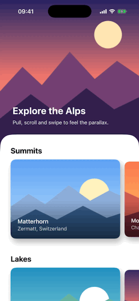

# ParallaxKit

Stretchy headers and parallax carousels for SwiftUI.


[](LICENSE)

<p align="center">
  
</p>

## Install

In Xcode, **File ▸ Add Package Dependencies…** and paste:

```
https://github.com/A-bv/ParallaxKit
```

## Use

```swift
import ParallaxKit

StretchyHeaderScrollView(title: "Explore the Alps") {
    Image("alps").resizable().scaledToFill()
} content: {
    ParallaxCarousel(trips) { trip in
        Image(trip.photo).resizable().scaledToFill()
    }
    .frame(height: 260)
}
```

- **`StretchyHeaderScrollView`**: a header that stretches and a rounded card that slides over it.
- **`StretchyHeader`**: the header alone, for your own `ScrollView`.
- **`ParallaxCarousel`**: cards whose images move as you swipe.

Every size, color and effect strength has a default you can change in the initializer, or in `ParallaxCarouselStyle` for the carousel.

## Try it

Open `Package.swift` in Xcode, then `Previews.swift`, and play with the demo in the canvas.

## License

MIT
